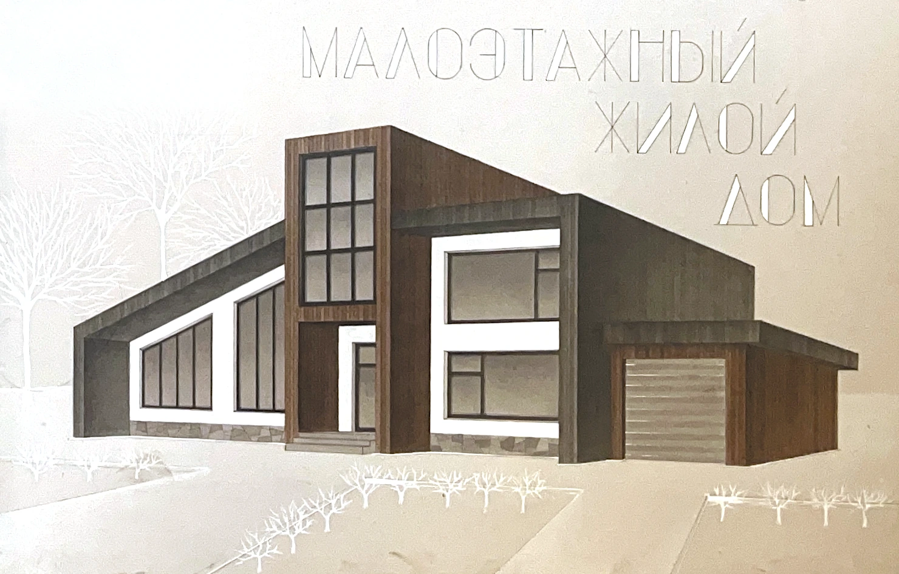

[**Русский**](README.md) | [English](README.en.md) | [中文](README.zh-CN.md)

# Виктория Терзян

**Архитектура и графика**

[Открыть портфолио ↗](https://gdvmeow.github.io/meowarch/)

Архитектурные проекты, ручная подача и академический рисунок.

[Портфолио](https://gdvmeow.github.io/meowarch/?page=portfolio) · [О себе](https://gdvmeow.github.io/meowarch/?page=about) · [Образование и опыт](https://gdvmeow.github.io/meowarch/?page=education) · [Контакты](https://gdvmeow.github.io/meowarch/?page=contacts)

---

[gdvmeow@gmail.com](mailto:gdvmeow@gmail.com)

[Telegram](https://t.me/gdvmeow) · [Behance](https://www.behance.net/gdvmeow) · [LinkedIn](https://www.linkedin.com/in/gdvmeow) · [Публикации](https://t.me/tori_arch)

© 2026 Виктория Терзян

